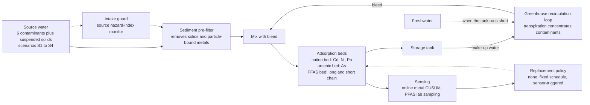
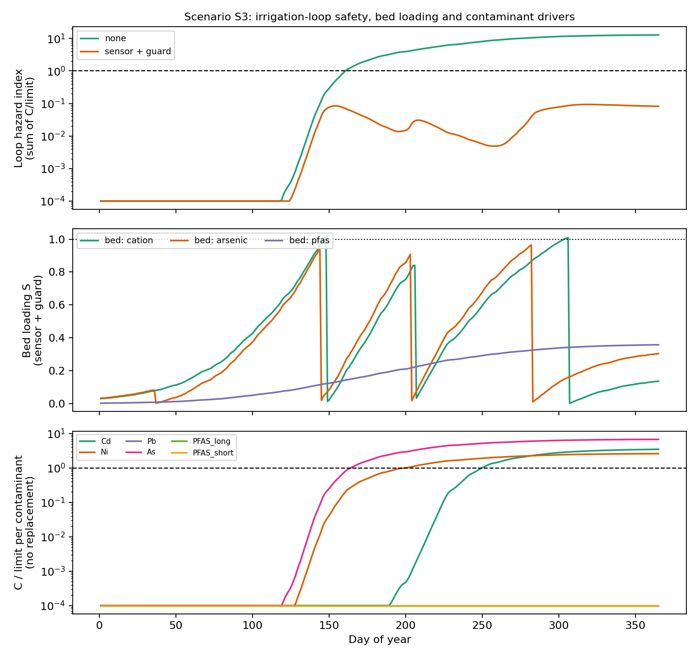
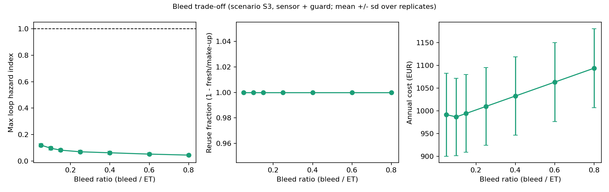
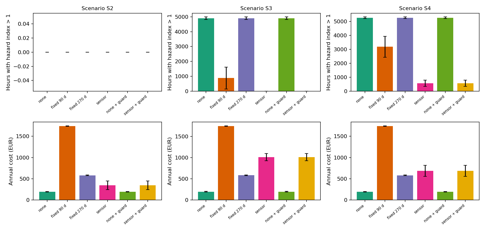
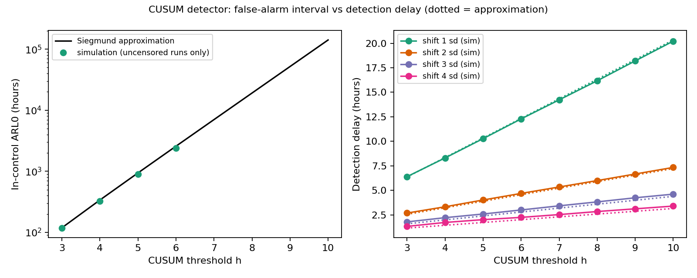
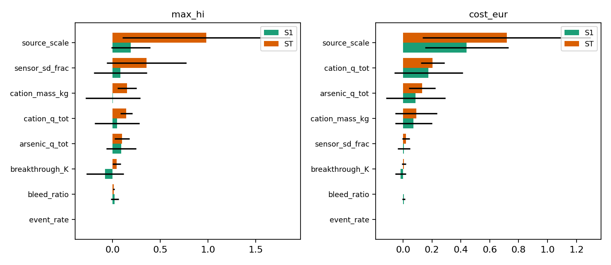
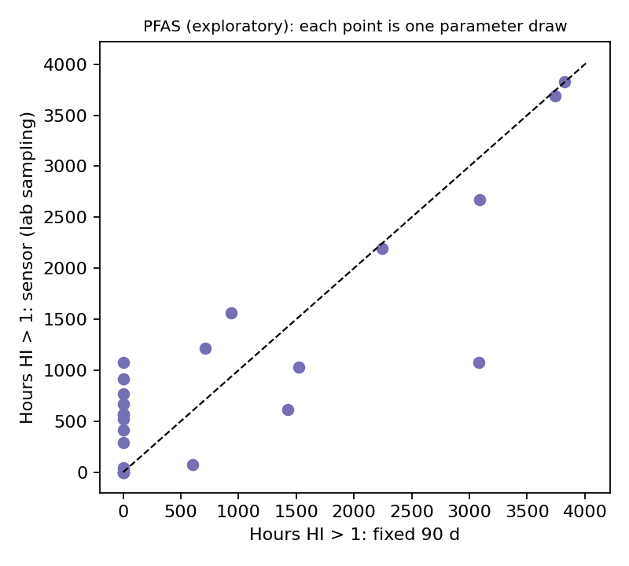
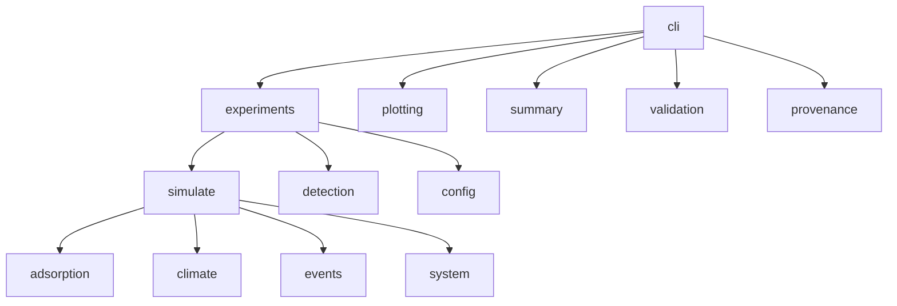

<div align="center">

# circular-greenhouse-water-nexus

**Multi-contaminant wastewater treatment and reuse in a circular greenhouse**

Heavy metals (Cd, Ni, Pb, As) · PFAS (exploratory) · sediment pre-filter · adsorption beds with breakthrough ·
hazard-index safety metric · sensor-based detection (CUSUM) · replacement policies · Sobol sensitivity · validation hook


[](https://github.com/meelad-sultan/circular-greenhouse-water-nexus/actions/workflows/ci.yml)

</div>

> **Read this first.**
> 1. This is a **stylised process model with illustrative parameters**, not a calibrated plant model. Every numeric
>    parameter is listed in [`data/parameters.csv`](data/parameters.csv) with a status (`illustrative`, `to verify`,
>    `standard value`, `scenario assumption`). Nothing has been tuned to a real installation.
> 2. **Validation against published breakthrough curves is pending.** A validation hook is implemented and tested on a
>    synthetic round trip only ([`validation/`](validation/README.md)). Do not read any result as validated.
> 3. **PFAS is an exploratory module.** Its parameters are wide guesses and its conclusions are tested for robustness, not asserted.
> 4. Weather, pollution events and sensor readings are **synthetic**. Scenario S3 uses **placeholder** concentrations.
> 5. Regulatory limits are configurable placeholders; verify the limits that apply to your jurisdiction.

---

## Table of contents
1. [Why this project](#1-why-this-project)
2. [Highlights](#2-highlights)
3. [System and data](#3-system-and-data)
4. [Method](#4-method)
5. [Experiments](#5-experiments)
6. [Results](#6-results)
7. [Validation hook](#7-validation-hook)
8. [Quickstart](#8-quickstart)
9. [Reproducing the study](#9-reproducing-the-study)
10. [Configuration and outputs](#10-configuration-and-outputs)
11. [Python API](#11-python-api)
12. [Using your own data](#12-using-your-own-data)
13. [Testing and CI](#13-testing-and-ci)
14. [Repository structure](#14-repository-structure)
15. [Troubleshooting](#15-troubleshooting)
16. [Limitations](#16-limitations)
17. [Roadmap](#17-roadmap)
18. [Citation, licence, references](#18-citation-licence-references)

---

## 1. Why this project

Reusing treated wastewater to irrigate a recirculating greenhouse saves water, but transpiration removes water and
leaves contaminants behind, so concentrations in the irrigation loop creep up. Operators must decide how much of the
loop to bleed, when to replace saturated adsorption media, and how to detect failure early, with different
contaminants (metals, PFAS) behaving and being monitored differently. This repository simulates that system hour by
hour for a year and asks:

1. **Safety:** how often does the combined hazard index of the irrigation water exceed 1 under different media-replacement policies?
2. **Detection:** how do sensor noise and CUSUM thresholds trade false alarms against detection delay, and what does that mean for operations?
3. **Robustness:** which parameters drive the outcomes (Sobol sensitivity), and do conclusions about PFAS survive wide parameter uncertainty?

## 2. Highlights

- Generic, configuration-driven **multi-contaminant** system: Cd, Ni, Pb (shared cation bed), As (own bed), two PFAS classes (own bed), plus a sediment pre-filter with particle-bound metal removal.
- **Thomas-type breakthrough** beds with an affinity-weighted competition rule that reduces exactly to the Thomas model for one species.
- **Exact contaminant mass balance** (relative error about 1e-15, enforced by tests).
- **CUSUM detection** with simulated operating characteristics checked against the Siegmund approximation.
- **Three monitoring regimes:** online metal sensors, PFAS lab sampling with delay, and an intake guard on the source.
- **Sobol global sensitivity** and an exploratory **PFAS robustness** analysis over a Latin hypercube of wide parameter ranges.
- A **validation hook** to fit published breakthrough curves, a **provenance table** for every parameter, 30 automated tests, CI.

## 3. System and data

### 3.1 Process



### 3.2 Contaminants and beds

| Contaminant | Kind | Bed | Limit used (ug/L) | Relative affinity | Particle-bound fraction |
|---|---|---|---|---|---|
| Cd | metal | cation | 10 | 3 | 0.10 |
| Ni | metal | cation | 200 | 1 | 0.10 |
| Pb | metal | cation | 50 | 10 | 0.40 |
| As | metal (anion) | arsenic | 50 | 1 | 0.05 |
| PFAS (long chain) | exploratory | pfas | 0.1 | 10 | 0 |
| PFAS (short chain) | exploratory | pfas | 0.1 | 1 | 0 |

Cd, Ni and Pb are cations and can share a bed; arsenic is mostly an anion in water and needs a different medium, so it
has its own bed; PFAS needs a different treatment again. Limits are **placeholders to verify**: Cd (0.01 mg/L) and Ni
(0.2 mg/L) follow FAO-style irrigation guidelines as cited in secondary sources; Pb and As use conservative placeholders
because published values vary widely by jurisdiction; the PFAS limit is an exploratory screening value.

### 3.3 Where the inputs come from

| Input | Origin | Status |
|---|---|---|
| Weather (hourly radiation, temperature, humidity) | Synthetic generator for a NW-European site (`climate.py`); real CSV supported | Synthetic by design |
| Crop transpiration | Simple radiation + VPD model scaled by canopy development | Illustrative |
| Pollution events | Random pulses (rate, duration, magnitude, affected metals) | Synthetic by design |
| Sensor readings | True value plus noise (online metals) or delayed noisy lab samples (PFAS) | Assumption |
| Adsorption capacity, steepness, affinities | Illustrative values; **to be checked against literature** | Illustrative |
| Limits | FAO-style guidelines or placeholders | To verify |
| Scenario concentrations | S1 low baseline; S2 episodic discharges; S3 chronic (PLACEHOLDER: replace with your own measurement ranges); S4 PFAS present (exploratory) | Scenario assumptions |

### 3.4 How comparisons are made

1. **Model vs published data (validation):** pending; see [section 7](#7-validation-hook).
2. **Model vs theory (verification):** analytic Thomas formula, contaminant mass-balance closure, and CUSUM run lengths against the Siegmund approximation (all in the tests).
3. **Strategy vs strategy:** every policy is run on identical simulated years (same weather, events and noise per replicate); results are medians with interquartile ranges, plus paired comparisons.
4. **Uncertainty:** Sobol sensitivity, and a PFAS robustness sweep over wide ranges.

## 4. Method

Equations and assumptions are in [`docs/method.md`](docs/method.md); summary:

- **Loop:** transpiration leaves without contaminants, so the loop concentrates them (steady-state factor about `1 + 1/bleed_ratio`). A bleed stream returns to treatment; make-up water comes from the tank, with freshwater when the tank runs short.
- **Bed:** `f_i = 1 / (1 + exp(K (1 - S_i)))`, `S_i = L / a_i`, `L = sum_j a_j fed_j / cap`. One species: exactly Thomas. Several species: a stylised competition rule where higher affinity breaks through later.
- **Safety metric:** hazard index `HI = sum_i C_i / limit_i` in the irrigation loop; exposure = hours with `HI > 1`.
- **Policies:** replacement is `none`, `fixed` (every N days) or `sensor` (online CUSUM on metals; delayed lab sampling for PFAS); the optional intake guard blocks the source when its hazard-index reading jumps above its running baseline.
- **Mass balance:** source mass in = pre-filter removal + adsorbed + overflow + crop uptake + storage.

## 5. Experiments

| ID | Experiment | Question | Design (default config) |
|---|---|---|---|
| E1 | Baseline year | What does the system do with and without replacement? | Scenario S3, one seed, two policies, daily series |
| E2 | Bleed trade-off | How do bleed ratio, safety, reuse and cost interact? | Scenario S3, 7 ratios, 10 replicates |
| E3 | Policy comparison | Which replacement and guard policy keeps water safe at what cost? | Scenarios S2, S3, S4; 6 policies; 10 paired replicates |
| E4 | Detector operating characteristics | False-alarm interval vs detection delay | CUSUM, k = 0.5, h from 3 to 10, shifts 1 to 4 sd, 2000 runs |
| E5 | Sobol sensitivity | Which parameters matter? | 8 parameters, scenario S3, 120-day horizon, N = 32 (320 runs) |
| E6 | PFAS robustness (exploratory) | Do PFAS conclusions survive parameter uncertainty? | Latin hypercube, 24 draws, scenario S4, 3 policies, 2 seeds |

## 6. Results

All tables below are generated by `python -m cgwn summary` from `results/metrics/`. Environment: Python 3.12.3, NumPy 2.4.4, SciPy 1.17.1, pandas 3.0.2, SALib 1.6.0.
The default configuration takes about 5 minutes on one core (about 80 s for E1 and E2, about 225 s for the rest);
the committed results were produced in several invocations of `cgwn run --only ...` with the same configuration and seeds.

##### E1: one simulated year, scenario S3 (single seed)

| policy | hours HI>1 | max HI | replacements | cost (EUR) | reuse fraction |
|---|---|---|---|---|---|
| none | 4911 | 12.82 | 0 | 204 | 1.000 |
| sensor + guard | 0 | 0.09 | 7 | 1126 | 1.000 |

##### E2: bleed trade-off (mean over replicates; scenario S3, sensor + guard)

| bleed ratio | conc. factor 1+1/b | hours HI>1 | max HI | reuse fraction | freshwater m3 | replacements | cost EUR |
|---|---|---|---|---|---|---|---|
| 0.05 | 21.0 | 0.0 | 0.12 | 1.0 | 0.0 | 6.3 | 992.0 |
| 0.1 | 11.0 | 0.0 | 0.1 | 1.0 | 0.0 | 6.2 | 987.0 |
| 0.15 | 7.7 | 0.0 | 0.08 | 1.0 | 0.0 | 6.2 | 994.0 |
| 0.25 | 5.0 | 0.0 | 0.07 | 1.0 | 0.0 | 6.2 | 1010.0 |
| 0.4 | 3.5 | 0.0 | 0.06 | 1.0 | 0.0 | 6.2 | 1033.0 |
| 0.6 | 2.7 | 0.0 | 0.05 | 1.0 | 0.0 | 6.2 | 1063.0 |
| 0.8 | 2.2 | 0.0 | 0.05 | 1.0 | 0.0 | 6.2 | 1094.0 |

##### E3: replacement and guard policies (median [IQR] over replicates, identical weather/events per replicate)

| scenario | policy | hours HI>1 | max HI | replacements | premature | cost EUR |
|---|---|---|---|---|---|---|
| S2 | none | 0 [0, 0] | 0.00 [0.00, 0.00] | 0 [0, 0] | 0 [0, 0] | 194 [190, 198] |
| S2 | fixed 90 d | 0 [0, 0] | 0.00 [0.00, 0.00] | 12 [12, 12] | 12 [12, 12] | 1740 [1736, 1744] |
| S2 | fixed 270 d | 0 [0, 0] | 0.00 [0.00, 0.00] | 3 [3, 3] | 3 [3, 3] | 581 [576, 584] |
| S2 | sensor | 0 [0, 0] | 0.00 [0.00, 0.00] | 1 [1, 2] | 1 [0, 2] | 327 [312, 444] |
| S2 | none + guard | 0 [0, 0] | 0.00 [0.00, 0.00] | 0 [0, 0] | 0 [0, 0] | 194 [190, 198] |
| S2 | sensor + guard | 0 [0, 0] | 0.00 [0.00, 0.00] | 1 [1, 2] | 1 [1, 2] | 327 [312, 444] |
| S3 | none | 4912 [4868, 4949] | 11.80 [11.26, 12.25] | 0 [0, 0] | 0 [0, 0] | 196 [191, 199] |
| S3 | fixed 90 d | 781 [173, 1493] | 1.22 [0.84, 1.50] | 12 [12, 12] | 7 [7, 8] | 1742 [1737, 1745] |
| S3 | fixed 270 d | 4912 [4868, 4949] | 9.12 [8.42, 9.66] | 3 [3, 3] | 1 [1, 1] | 582 [578, 586] |
| S3 | sensor | 0 [0, 0] | 0.07 [0.06, 0.08] | 6 [6, 7] | 1 [0, 1] | 988 [981, 1075] |
| S3 | none + guard | 4912 [4868, 4949] | 11.80 [11.26, 12.25] | 0 [0, 0] | 0 [0, 0] | 196 [191, 199] |
| S3 | sensor + guard | 0 [0, 0] | 0.07 [0.06, 0.08] | 6 [6, 7] | 1 [0, 1] | 988 [981, 1075] |
| S4 | none | 5279 [5231, 5311] | 13.17 [12.91, 13.33] | 0 [0, 0] | 0 [0, 0] | 194 [190, 198] |
| S4 | fixed 90 d | 3454 [2876, 3722] | 2.83 [2.37, 3.15] | 12 [12, 12] | 10 [10, 10] | 1740 [1736, 1744] |
| S4 | fixed 270 d | 5279 [5231, 5311] | 11.88 [11.51, 12.13] | 3 [3, 3] | 2 [2, 2] | 581 [576, 584] |
| S4 | sensor | 528 [401, 599] | 1.41 [1.35, 1.72] | 4 [3, 5] | 1 [1, 2] | 695 [606, 790] |
| S4 | none + guard | 5279 [5231, 5311] | 13.17 [12.91, 13.33] | 0 [0, 0] | 0 [0, 0] | 194 [190, 198] |
| S4 | sensor + guard | 528 [401, 599] | 1.41 [1.35, 1.72] | 4 [3, 5] | 1 [1, 2] | 695 [606, 790] |

Paired comparison:
- S2: sensor + guard vs fixed 90 d: exposure lower or equal in 100% of replicates, cost lower in 100%, median cost difference -1415 EUR
- S3: sensor + guard vs fixed 90 d: exposure lower or equal in 100% of replicates, cost lower in 100%, median cost difference -760 EUR
- S4: sensor + guard vs fixed 90 d: exposure lower or equal in 100% of replicates, cost lower in 100%, median cost difference -1046 EUR

##### E4: CUSUM operating characteristics (k = 0.5; hours, standardised iid normal data)

| h | sim in-control ARL0 | sim shift 1sd | sim shift 2sd | sim shift 3sd | sim shift 4sd | ARL0 Siegmund approx. | in-control runs censored |
|---|---|---|---|---|---|---|---|
| 3 | 117.4 | 6.4 | 2.7 | 1.8 | 1.3 | 119.0 | 0.0 |
| 4 | 325.2 | 8.3 | 3.3 | 2.2 | 1.7 | 338.0 | 0.0 |
| 5 | 892.8 | 10.3 | 4.0 | 2.6 | 2.0 | 938.0 | 0.0 |
| 6 | 2379.0 | 12.3 | 4.7 | 3.0 | 2.2 | 2573.0 | 0.01 |
| 7 | censored | 14.2 | 5.3 | 3.4 | 2.5 | 7020.0 | 0.19 |
| 8 | censored | 16.2 | 6.0 | 3.8 | 2.8 | 19112.0 | 0.51 |
| 9 | censored | 18.2 | 6.7 | 4.2 | 3.1 | 51985.0 | 0.79 |
| 10 | censored | 20.2 | 7.3 | 4.6 | 3.4 | 141347.0 | 0.92 |

##### E5: Sobol sensitivity (S1 = first-order, ST = total effect; +/- 95% bootstrap CI)

| output | parameter | S1 | ST |
|---|---|---|---|
| max_hi | source_scale | 0.19 +/- 0.21 | 0.98 +/- 0.88 |
| max_hi | sensor_sd_frac | 0.08 +/- 0.28 | 0.35 +/- 0.42 |
| max_hi | cation_mass_kg | 0.00 +/- 0.29 | 0.15 +/- 0.10 |
| max_hi | cation_q_tot | 0.05 +/- 0.24 | 0.14 +/- 0.06 |
| cost_eur | source_scale | 0.44 +/- 0.29 | 0.72 +/- 0.58 |
| cost_eur | cation_q_tot | 0.18 +/- 0.24 | 0.21 +/- 0.08 |
| cost_eur | arsenic_q_tot | 0.09 +/- 0.21 | 0.13 +/- 0.09 |
| cost_eur | cation_mass_kg | 0.07 +/- 0.13 | 0.09 +/- 0.15 |

##### E6: PFAS robustness (EXPLORATORY; scenario S4, wide parameter ranges)

- Parameter draws: 24 (Latin hypercube over PFAS capacity, affinity ratio, lab interval, lab delay)
- Sensor-based (lab-sampling) policy has exposure <= fixed 90 d in 50% of draws and <= no replacement in 100%
- Median hours with HI > 1: none 1817, fixed 90 d 0, sensor 642
- Median cost (EUR): none 159, fixed 90 d 932, sensor 415


### 6.1 Figures

| | |
|---|---|
|  |  |
| **Fig. 1.** Baseline year: loop hazard index, bed loading and per-contaminant drivers | **Fig. 2.** Bleed trade-off |
|  |  |
| **Fig. 3.** Policy comparison across scenarios | **Fig. 4.** CUSUM operating characteristics |
|  |  |
| **Fig. 5.** Sobol indices | **Fig. 6.** PFAS robustness (exploratory) |

### 6.2 What the results support

1. **Treatment is essential in the chronic scenario.** In S3 with no media replacement the loop hazard index is above 1 for about 4,900 of 8,760 hours (maximum about 12). Cd, Ni and As each exceed their own limit in the daily-mean loop concentration (116, 165 and 201 days in the baseline run); Pb and the PFAS classes do not. The episodic scenario S2 never exceeds the limit in any policy (E3).
2. **A sensor-triggered policy is the only one that keeps S3 safe at moderate cost.** Sensor policy: 0 hours above the limit (IQR 0 to 0), 6 replacements, about 988 EUR per year. Fixed 90 d: median 781 hours (IQR 173 to 1,493), 12 replacements, about 1,742 EUR. Fixed 270 d: about 4,912 hours (no better than no replacement). In S3 the sensor policy had no higher exposure and lower cost than fixed 90 d in 100 % of 10 paired replicates. This rests on the assumption of **online metal sensors with noise of 5 % of the limit**.
3. **Fixed schedules are not tuned.** Only 90 d and 270 d were compared; a tuned interval could close part of the gap. This is a limitation, not a finding about schedules in general.
4. **Pulses are buffered.** In S2 even the "no replacement" policy never exceeds the limit, because the bed absorbs short pulses at these parameters; the sensor policy causes about one premature replacement per year (consistent with a false alarm), and the intake guard fired only in S2 (596 blocked hours across 10 replicates), where it left exposure unchanged and cost differed slightly; in S3 and S4 it never triggered.
5. **The detector behaves as theory predicts.** Simulated in-control run lengths match the Siegmund approximation for thresholds up to h = 6 (for example h = 5: 893 h simulated vs 938 h approximate). At h = 8 (the default) the approximate in-control run length is about 19,100 h (about 2.2 years) and the delay for a 2-standard-deviation shift is about 6 h. Simulated in-control values for h of 7 or more are censored (runs longer than 12,000 h) and are not shown.
6. **Mass is conserved.** Relative mass-balance error is about 1e-15 in every run.

### 6.3 What the results do **not** support

- **No reuse-versus-safety trade-off appeared in E2.** With working treatment every bleed ratio stayed safe, reuse stayed at 100 %, and only the cost rose slightly with bleed (about 990 to 1,090 EUR), while the maximum hazard index fell from about 0.12 to 0.05. The treatment capacity never became limiting at these parameters, so the expected tension between bleed and reuse was not exercised. A weaker treatment or a binding capacity limit would be needed to explore it (see the roadmap).
- **The Sobol results are indicative only.** With N = 32 the confidence intervals are wide (for example a total-effect index of 0.98 with an interval of about 0.9). Source concentration scale was the largest contributor to the maximum hazard index and to cost. Exposure fraction and reuse fraction had no variance across the samples and were not analysed. Increase N before drawing conclusions.
- **PFAS conclusions are not robust (E6).** The lab-sampling policy had exposure no higher than the 90-day schedule in only about half of the parameter draws (while always being no worse than no replacement), while costing less (median 415 vs 932 EUR). Which is better depends on capacity, affinity ratio and lab delay, so **no PFAS policy recommendation is made**.
- **No validated predictions.** See the status of the validation hook.
- **No real-world magnitudes.** Parameters are illustrative; scenario S3 uses placeholder concentrations.

## 7. Validation hook

Status: **pending** (implemented and tested on a synthetic round trip only).

```bash
python -m cgwn validate --selftest --out validation/outputs                       # synthetic check of the fitting code
python -m cgwn validate --points my_points.csv --conditions my_conditions.yaml --out validation/outputs/my_paper
```

The hook fits the Thomas model `C/C0 = 1 / (1 + exp(kTh/Q (q0 m - C0 Q t)))` to digitised points from a published column
experiment and reports fitted `q0` and `kTh`, R2, the equivalent bed steepness `K`, and the relative error in the times
to 10 % and 50 % breakthrough. Candidate open-access studies (Pb, Cd, Ni) are listed in
[`validation/candidates.md`](validation/candidates.md); they have **not** been checked by the author yet. Validation covers
the single-species breakthrough shape only, not the multi-metal competition rule, PFAS, or plant-scale behaviour.

## 8. Quickstart

Requirements: Python 3.10 or newer; no commercial software.

```bash
git clone https://github.com/meelad-sultan/circular-greenhouse-water-nexus.git
cd circular-greenhouse-water-nexus
python -m venv .venv
source .venv/bin/activate            # Windows (PowerShell): .venv\Scripts\Activate.ps1
python -m pip install --upgrade pip
python -m pip install -e ".[dev]"

python -m pytest                                                      # about 10 s
python -m cgwn run --config configs/quick.yaml --out results/quick    # about 30 s
python -m cgwn figures --results results/quick --out results/quick/figures
```

If PowerShell blocks activation: `Set-ExecutionPolicy -Scope Process -ExecutionPolicy Bypass`.

## 9. Reproducing the study

```bash
python -m cgwn run --config configs/default.yaml --out results/metrics      # about 5 minutes
python -m cgwn figures --results results/metrics --out results/figures
python -m cgwn summary --results results/metrics > results/metrics/summary.md
python -m cgwn params --out data/parameters.csv                              # parameter provenance table
```

Results depend only on the seed and configuration. Each replicate uses seed + replicate index; a given seed fixes the
weather, events and sensor noise, so policies are compared on identical conditions. Library versions or operating
systems may cause tiny numerical differences. Single experiments: `--only baseline bleed policies detector sensitivity pfas`.

## 10. Configuration and outputs

Everything is configured in [`configs/default.yaml`](configs/default.yaml) (`configs/quick.yaml` inherits from it with `extends:`).

| Section | Contents |
|---|---|
| `site`, `crop`, `loop`, `tank` | greenhouse size and climate response, loop volume and bleed ratio, tank and intake limits |
| `contaminants` | name, kind, molar mass, limit, bed, affinity, particle-bound fraction, crop uptake fraction |
| `treatment` | energy intensities, pre-filter, beds (basis, capacity `q_tot`, mass, steepness `K`, media cost) |
| `sensors` | sensor noise, CUSUM `k` and `h`, hold time, intake-guard rule, PFAS lab interval, delay and noise |
| `scenarios` | S1 to S4: baseline concentrations, suspended solids, event rate and magnitude |
| `experiments` | settings for E1 to E6, including Sobol parameter ranges |

| Output file (`results/metrics/`) | Content |
|---|---|
| `baseline_daily.csv`, `baseline_kpis.json` | E1 daily series and annual KPIs |
| `bleed_tradeoff.csv` | E2 KPIs per bleed ratio and replicate |
| `policy_comparison.csv` | E3 KPIs per scenario, policy and replicate |
| `detector_oc.csv` | E4 simulated and approximate run lengths |
| `sensitivity_sobol.csv` | E5 first-order and total indices with confidence intervals |
| `pfas_robustness.csv` | E6 per-draw exposure and cost by policy |
| `summary.md`, `run_metadata.json` | markdown tables; configuration, versions and timings |

Key KPIs: `exposure_h` (hours with HI > 1), `max_hi`, `reuse_frac`, `replacements`, `premature_replacements` (bed
replaced while its loading was below 0.5), `bed_breakthrough_h`, `cost_eur`, `energy_kwh_per_m3_reused`, `co2_kg`,
`mass_balance_rel_err`.

## 11. Python API

```python
from cgwn.config import load_config, set_path
from cgwn.simulate import Policy, run_scenario

cfg = load_config("configs/default.yaml")
res = run_scenario(cfg, "S3", Policy("sensor", guard=True), seed=1)        # one simulated year
print(res.kpis["exposure_h"], res.kpis["cost_eur"], res.kpis["mass_balance_rel_err"])

cfg2 = set_path(cfg, "loop.bleed_ratio", 0.4)                              # change any parameter by dotted path
print(run_scenario(cfg2, "S3", Policy("fixed", guard=False, interval_days=90), seed=1).kpis["replacements"])
```

## 12. Using your own data

- **Weather:** `cgwn.climate.load_climate_csv(path, site)` reads hourly `radiation_wm2`, `temp_c` (and optional `rh`); pass the result into `cgwn.simulate.simulate` together with a source from `cgwn.events.make_source`.
- **Source concentrations:** replace the S3 placeholder values in `configs/default.yaml` with ranges from your own measurements. If they come from a thesis or an unpublished dataset, confirm that you may publish them.
- **Parameters:** update `status` and `note` for each parameter you verify against literature (re-export with `cgwn params`).
- **Contaminants and beds:** add an entry under `contaminants` and, if needed, a bed under `treatment.beds`; no code changes are required.

## 13. Testing and CI

```bash
python -m pytest        # 30 tests
python -m ruff check .
```

| Test file | What it verifies |
|---|---|
| `test_adsorption.py` | single-species bed equals the Thomas formula and the validation module's curve; mass conservation; higher affinity breaks through later; reset; loading definition |
| `test_inputs.py` | climate shapes, determinism and non-negativity; seasonal transpiration; scenario baselines and events; scale factor |
| `test_detection.py` | Siegmund reference values; simulated in-control run length within 10 % of theory; delay falls with shift size; ARL0 rises with threshold |
| `test_simulation.py` | mass balance closes for every scenario and policy; determinism and seed sensitivity; tank and hazard-index bounds; fixed-schedule replacement count; clean source gives no exposure; treatment is needed in S3 and the sensor policy helps; breakthrough follows saturation |
| `test_validation.py` | fit recovers known parameters from noisy synthetic data; time-to-breakthrough inverts the curve; self-test and user-file paths |
| `test_pipeline.py` | end-to-end smoke test of all experiments, figures and summary; parameter table has provenance columns |

GitHub Actions (`.github/workflows/ci.yml`) runs lint and tests on Python 3.10 and 3.12 for every push and pull request.

## 14. Repository structure

```text
circular-greenhouse-water-nexus/
├── README.md  LICENSE  CITATION.cff  pyproject.toml
├── configs/        default.yaml  quick.yaml
├── data/           parameters.csv  (parameter provenance table)
├── docs/           method.md  architecture.md  NEXT_STEPS.md
├── src/cgwn/       climate.py  events.py  system.py  adsorption.py  detection.py  simulate.py
│                   experiments.py  validation.py  provenance.py  summary.py  plotting.py  config.py  cli.py
├── tests/          conftest.py  test_adsorption.py  test_inputs.py  test_detection.py
│                   test_simulation.py  test_validation.py  test_pipeline.py
├── validation/     README.md  candidates.md  conditions_template.yaml  points_template.csv
├── results/        metrics/ (CSV, JSON, summary.md)   figures/ (PNG)
└── .github/workflows/ci.yml
```

### Module dependencies



## 15. Troubleshooting

| Problem | Likely fix |
|---|---|
| `ModuleNotFoundError: SALib` | `python -m pip install -e ".[dev]"` (SALib is a declared dependency) |
| Sobol step warns about sample size | N should be a power of two; the default 32 is intentionally small and gives wide intervals |
| Full run takes too long | use `configs/quick.yaml`, or `--only` a subset, or reduce `replicates`, `N`, `draws` |
| Results differ slightly from the README | library versions or OS; compare `run_metadata.json`; replace the committed tables with yours |
| `validate` fails to fit | check units (`time_unit`, flow in mL/min, mass in g, `c0` in mg/L) and that the points span the S-shaped rise |

## 16. Limitations

1. **Stylised model.** Perfectly mixed tank and loop, hourly Euler steps, constant loop volume, simple crop transpiration, no plant-uptake dynamics beyond a fixed fraction, no pH, temperature or ionic-strength effects on adsorption.
2. **Competition rule is a heuristic** (affinity-weighted sharing of one capacity), not a mechanistic multi-component isotherm. Affinity rankings are illustrative.
3. **Parameters are illustrative** and only the structure of the model is checked by tests. Validation against published data is pending.
4. **PFAS** is lumped into two classes with mass-basis capacity, no precursors or competing ions; exploratory only.
5. **Sensing assumptions are optimistic:** online metal sensors with noise of 5 % of the limit; lab-only PFAS monitoring.
6. **Policy comparison** uses two untuned fixed intervals; the intake guard and the pulse events had no measurable effect on exposure at these parameters.
7. **Bleed trade-off not exercised:** treatment capacity never binds.
8. **Sensitivity analysis is small** (N = 32) and conditional on one weather and event realisation.
9. **Synthetic inputs:** weather, events and noise are generated; S3 concentrations are placeholders.
10. **Limits** are placeholders to verify; hazard-index summation is a screening idea, not a regulatory rule.

## 17. Roadmap

- Fit at least one published Pb, Cd and Ni column and one arsenic column; report agreement; update parameter status.
- Bleed trade-off under binding treatment capacity and weaker treatment.
- A tuned fixed-schedule comparator and cost-optimal replacement thresholds.
- Larger Sobol sample (N of 256 or more) and multiple weather and event realisations.
- Mechanistic multi-component isotherm for the cation bed; PFAS precursor and competition modelling.
- Real weather (KNMI or ERA5) and measured source-water ranges; link to the companion supply-chain repository.

## 18. Citation, licence, references

**Cite as** (see `CITATION.cff`): Sultan, M. M. (2026). *circular-greenhouse-water-nexus: multi-contaminant treatment and reuse in a circular greenhouse* (v0.1.0). GitHub repository.
**Licence:** MIT (see `LICENSE`).

**Author:** Muhammad Meelad Sultan · GitHub: [@meelad-sultan](https://github.com/meelad-sultan) · 

**References**:
- Thomas, H. C. (1944). Heterogeneous ion exchange in a flowing system. *Journal of the American Chemical Society* 66.
- Ben Amar, M., Mallek, M., Valverde, A., Monclús, H., Myers, T. G., Salvadó, V., Cabrera-Codony, A. (2024). Competitive heavy metal adsorption on pinecone shells: mathematical modelling of fixed-bed column and surface interaction insights
- Siegmund, D. (1985). *Sequential Analysis: Tests and Confidence Intervals*. Springer. (CUSUM run-length approximations)
- Balengayabo, J. G., Kassenga, G. R., Mgana, S. M., Salukele, F. (2024). Impact of recurring irrigation with treated domestic wastewater on heavy metal accumulation in the soil. Agricultural Water Management
- Page, E. S. (1954). Continuous inspection schemes. *Biometrika* 41. (CUSUM)
- Sobol, I. M. (2001). Global sensitivity indices for nonlinear mathematical models. *Mathematics and Computers in Simulation* 55.
- Zhang, Y., Thomas, A., Apul, O., Venkatesan, A. K. (2023). Coexisting ions and long-chain PFAS inhibit the adsorption of short-chain PFAS by granular activated carbon. Journal of Hazardous Materials.
- Herman, J. and Usher, W. (2017). SALib: an open-source Python library for sensitivity analysis. *Journal of Open Source Software* 2(9).
  Adsorption of Cu(II), Ni(II), Pb(II) and Cd(II) from ternary mixtures: modelling competitive breakthrough curves and assessment of sensitivity. Environmental Processes (2017)
- Ayers, R. S. and Westcot, D. W. (1985). *Water quality for agriculture*. FAO Irrigation and Drainage Paper 29. (irrigation guidelines; check current guidance)
- Candidate validation studies: see [`validation/candidates.md`](validation/candidates.md).
